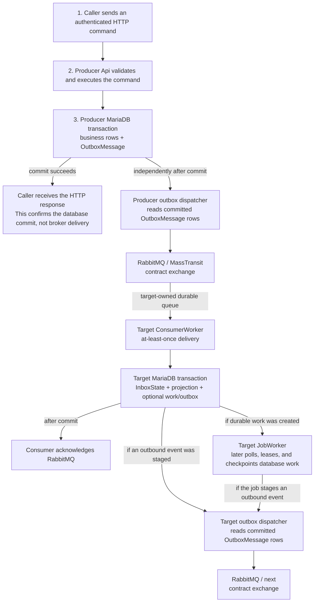
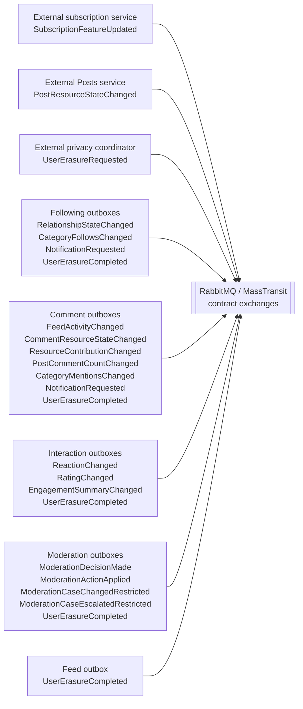
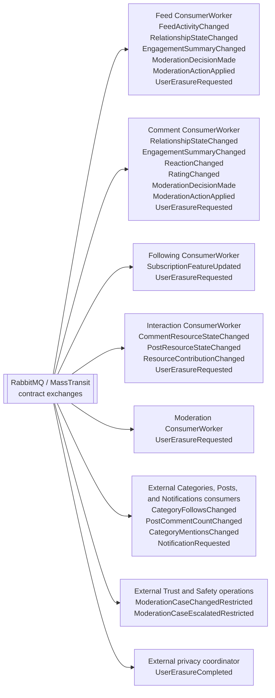

# Inspacy backend course

This repository is the .NET backend for five social-platform bounded contexts:
Feed, Following, Comment, Interaction, and Moderation. Read this document from top
to bottom the first time you work here; afterward, use it as an architecture and
contribution reference.

The system is a modular monorepo, not one monolith. Each service owns its HTTP API,
domain model, application use cases, persistence, queues, and background jobs. The
services share canonical building blocks and communicate through authenticated HTTP
calls or asynchronous integration events.

> The repository keeps the existing spelling `Infraestructure` in project and
> namespace names. Do not silently rename it while making an unrelated change.

## 0. Project summary

The five services form a content and engagement backend:

| Service | Owns | Does not own |
|---|---|---|
| Feed | Personalized activity delivery, audience projections, seen state, feed ranking inputs | The original comment/post, relationships, or engagement authority |
| Following | Follows, friendships, requests, blocks, category follows, relationship event streams and snapshots | User identity, category definitions, or notification delivery |
| Comment | Comment lifecycle, media, mentions, visibility, comment read models | Post authority, relationship authority, global interaction authority |
| Interaction | Reactions, ratings, views, engagement summaries and authoritative exports | Comment/post content or moderation cases |
| Moderation | Reports, cases, triage, investigation, decisions, appeals, audit, legal holds and retention | Applying every downstream content projection itself |

Identity, Categories, Posts, Notifications, and the privacy coordinator are external
platform boundaries. They are referenced by contracts and configuration but are not
implemented by this solution.

### Layer and process model

Every service follows the same dependency direction:

```text
Api --------------------> Application --------------------> Domain
 |                             ^
 |                             |
 +----> Infraestructure -------+
              |
              +-------------------------------------------> Domain
```

- `Domain` owns business behavior and contains no ASP.NET Core endpoints, EF
  mappings/DbContexts, Redis access, or RabbitMQ adapters.
- `Application` owns use cases and ports. It depends on Domain.
- `Infraestructure` implements persistence and provider ports. It depends on
  Application and Domain.
- `Api` is the composition and adapter boundary for HTTP, queues, and jobs.

The same API executable can start in one of five roles:

| Runtime role | Responsibility | Business HTTP | RabbitMQ consumers | Jobs | DDL |
|---|---|---:|---:|---:|---:|
| `Api` | Serve requests and publish through the outbox | Yes | No | No | No |
| `ConsumerWorker` | Run receive endpoints | No | Yes | No | No |
| `JobWorker` | Run background jobs | No | No | Yes | No |
| `Migration` | Apply EF/raw migrations, then exit | No | No | No | Yes |
| `Combined` | API + consumers + jobs for local development | Yes | Yes | Yes | No |

`Combined` is rejected outside Development. Production runs independently scalable
API, consumer, job, and migration workloads.

### Architecture

Each service name in this section means the bounded context and all of its workloads,
not only the project whose name ends in `.Api`. In production, the same image runs as
separate `Api`, `ConsumerWorker`, `JobWorker`, and one-shot `Migration` workloads. An
API never owns a receive endpoint, and a job never consumes a RabbitMQ queue. Local
Development uses `Combined`, so those roles share a process without changing the data
flow.

#### Production request, event, and job path

This is the path for a write that produces an integration event and eventually creates
durable work in another service:



A query normally stops at the service's MariaDB read model, with Redis used only where
listed below. It does not synchronously query another service to rebuild missing state.
The `Migration` role has only DDL access, never starts the broker, and exits after
applying EF/raw migrations.

#### Event topology

For two in-repository services, an arrow through RabbitMQ represents: producer
transaction -> producer EF bus outbox -> MassTransit contract exchange ->
consumer-owned durable queue. It is not a direct API-to-API call. External arrows prove
the shared contract boundary only; the external implementation, durability mechanism,
and queue names are outside this repository. Exchanges are derived from CLR contract
types; the stable names maintained here are the receive queues in the catalog below.

**Publish side — who emits each contract:**



**Consume side — who receives each contract:**



The external producers and consumers in that diagram are contract boundaries; their
implementations are not present in this solution.

#### Concrete end-to-end flows

1. **Comment publication:** `POST`/`PATCH /api/comments` validates the caller and,
   for media, records a durable ingestion, writes private quarantine storage, verifies
   type/hash/dimensions and ClamAV, then promotes the object. The Comment transaction
   saves the aggregate and conditionally stages `FeedActivityChanged`,
   `CommentResourceStateChanged`, `ResourceContributionChanged`,
   `PostCommentCountChanged`, `CategoryMentionsChanged`, and
   `NotificationRequested`. Feed's consumer persists the canonical activity and, for
   push delivery or revocation, may create a `FanoutWorkItem` or
   `FeedRevocationWorkItem`; active pull/owner-only activity needs no delivery work.
   `FeedDeliveryJob` later leases any created work and materializes or revokes
   `FeedEntry` rows. Interaction's consumers establish comment lifecycle/contribution
   authority and can publish a new `EngagementSummaryChanged` through their own outbox.

2. **Relationship change:** a Following API mutation, subscription consumer, or
   erasure job advances the durable relationship stream and stages
   `RelationshipStateChanged`. Feed and Comment consumers independently update their
   local, versioned audience projections. Their audience-bootstrap jobs repair those
   projections by obtaining a client-credentials token and pulling a bounded,
   fixed-high-watermark page from Following's internal snapshot endpoint; ordinary Feed
   and Comment request paths do not call Following.

3. **Reaction, rating, and view:** Interaction API reaction/rating commands update
   Interaction MariaDB and stage the per-user change plus
   `EngagementSummaryChanged`. A view request only stores a bounded, deduplicated
   observation and returns `202`; `InteractionViewAggregationJob` aggregates it and
   stages the summary later. Feed consumes summaries for response hydration. Comment
   consumes summaries, reactions, and ratings into its read projections.

4. **Moderation:** report/case API commands commit case, audit, and restricted workflow
   signals together. A final decision always stages `ModerationDecisionMade` and stages
   `ModerationActionApplied` when the action is not `NoAction`. Feed and Comment consume
   those versions into fail-closed suppression/release projections. The SLA job polls
   overdue cases and publishes `ModerationCaseEscalatedRestricted`. Retention only
   mutates Moderation-owned data: case/report retention is disabled by default, while
   eligible superseded decision revisions are still pruned.

5. **User erasure:** the external coordinator publishes one
   `UserErasureRequested` contract that fans out to five service-owned queues. Each
   ConsumerWorker records or supersedes a permanent tombstone; a stale or superseded
   request can also stage an immediate `UserErasureCompleted` acknowledgement. It does
   not scan large tables on the delivery thread. The service-owned erasure jobs lease
   tombstones, delete or pseudonymize bounded pages, checkpoint progress, and stage
   completion. Comment, Following, and Interaction also emit their normal
   deletion/revocation projection events when erasure changes public state. Moderation's
   erasure processor is disabled by default and must be explicitly enabled to run.

#### API, consumer, job, and state ownership

| Service | API role | ConsumerWorker effect | JobWorker flow | Authoritative state and direct dependencies |
|---|---|---|---|---|
| Feed | Reads a signed-cursor page by merging materialized push entries with authorized pull activities; marks activities seen. Seen writes publish nothing. | Projects activity, relationship, engagement, moderation, and privacy contracts; creates fan-out/revocation work where required. | `FeedDeliveryJob` leases revocation before fan-out work; `FeedAudienceBootstrapJob` pulls Following snapshots; `FeedMaintenanceJob` compacts/replays durable state; `FeedUserErasureJob` publishes only its completion. | Feed MariaDB; optional L1/Redis L2 first-page cache; RabbitMQ; Identity + Following HTTP for the bootstrap job. |
| Following | Mutates/lists follows, friendships, requests, blocks, and category follows; exposes the internal relationship snapshot. Mutations can publish relationship, category, and notification contracts. | Applies `SubscriptionFeatureUpdated`; records privacy tombstones. A subscription change can publish a relationship transition. | `FollowingUserErasureJob` removes relationship/category state in bounded pages and publishes relationship revocations, category deltas, and completion. | Following MariaDB; RabbitMQ; Identity + Categories HTTP for category-name resolution. |
| Comment | CRUD/cursor reads and protected media streaming; multipart writes run the durable quarantine/scan/promote flow. Reads use only local projections plus private object storage. | Projects Following relationships, Interaction summary/reaction/rating, Moderation decisions/actions, and privacy tombstones; stale privacy requests can stage a superseded completion. | `CommentAudienceBootstrapJob` pulls Following snapshots; `CommentMediaReconciliationJob` resumes/compensates media and exact-object cleanup; `CommentUserErasureJob` emits normal deletion events plus completion. | Comment MariaDB; RabbitMQ; private MinIO/OCI storage; ClamAV-compatible scanner; Identity + Following HTTP for the bootstrap job. |
| Interaction | Owns reaction/rating mutations, accepted view observations, engagement/status reads, and the bounded authority export. | Projects Comment/Post resource lifecycle and absolute contributions; records privacy tombstones. Resource/contribution changes can produce corrected summaries. | `InteractionViewAggregationJob` publishes summaries; `InteractionCounterReconciliationJob` corrects counters, monitors projection-gap backlog, and prunes revisions; `InteractionUserErasureJob` publishes reaction/rating/summary corrections and completion. | Interaction MariaDB; optional L1/Redis L2 engagement cache; RabbitMQ. |
| Moderation | Owns report, triage, investigation, decision, appeal, audit, hold, admin, and bounded decision-export routes. | Records privacy tombstones; stale requests can publish a superseded completion. | `ModerationSlaEscalationJob` publishes restricted escalations. `ModerationRetentionJob` always prunes eligible decision revisions but case/report retention is disabled by default. `ModerationUserErasureJob` respects legal holds and publishes completion when explicitly enabled; it is disabled by default. | Moderation MariaDB; RabbitMQ. |

#### Synchronous and infrastructure edges

| Caller / role | Target | Actual purpose |
|---|---|---|
| Client or service caller | Any API | Sends an HTTP bearer token. The API validates it through OpenIddict; the default introspection mode calls the external Identity provider, while discovery mode fetches issuer metadata/keys and validates locally. |
| Feed `JobWorker` | Identity, then Following API | Obtains a dedicated client-credentials token, then pages `/api/internal/relationships/snapshot` for audience bootstrap/reconciliation. |
| Comment `JobWorker` | Identity, then Following API | Performs the same bounded snapshot pull for Comment's visibility projection. |
| Following `Api` | Identity, then external Categories API | Obtains a scoped service token and resolves a category name before a category-follow mutation when required. |
| Comment `Api` and `JobWorker` | MinIO or OCI Object Storage; ClamAV-compatible scanner | Quarantines, verifies, promotes, streams, compensates, and deletes private media objects. |
| Feed `Api`; Interaction `Api`, `ConsumerWorker`, and `JobWorker` | Redis through HybridCache | Feed caches eligible first pages. Interaction caches versioned public engagement summaries and invalidates them after API, consumer, or job mutations. Redis is disposable; MariaDB remains authoritative. |
| External authorized recovery/operations client | Interaction authoritative export or Moderation decision-state export | Pulls a bounded, signed-cursor authority snapshot. No caller for either internal endpoint is implemented in this repository; neither export is a queue. |
| Every non-migration broker role | RabbitMQ | Publishes committed outbox rows; in production only `ConsumerWorker` starts receive endpoints (`Combined` also does so in Development). |
| Every service workload | Its own MariaDB | API, consumer, and job roles use service-scoped DML; the Migration role uses DDL. No service queries another service's tables. |

All workloads can emit traces/metrics to the configured OTLP collector. Local
Compose uses one MariaDB container but distinct service connection strings, plus
RabbitMQ, Redis, MinIO, and one Development `Combined` container per service. Production
uses independently scalable role workloads and external production-grade dependencies.

#### RabbitMQ receive endpoint catalog

| Publisher | Contract | Consumer-owned queue | Consumer transaction / durable effect |
|---|---|---|---|
| External subscription service | `SubscriptionFeatureUpdated` | `following_subscription_feature_networking_queue` | Updates Following's friends-subscription feature and may stage a relationship transition. |
| Following | `RelationshipStateChanged` | `feed_following_relationship_state_queue` | Advances Feed audience edges/checkpoints, delivery modes, and required revocation work. |
| Following | `RelationshipStateChanged` | `comment_following_relationship_state_queue` | Advances Comment visibility edges/checkpoints; gaps remain fail closed. |
| Comment | `FeedActivityChanged` | `feed_activity_changed_queue` | Versions the canonical activity and may create fan-out or revocation work when its state/delivery mode requires it. |
| Comment | `CommentResourceStateChanged` | `interaction-comment-resource-state` | Advances Interaction's comment lifecycle/visibility authority and removes deleted-resource interaction state. |
| Comment | `ResourceContributionChanged` | `interaction-resource-contribution` | Applies absolute contribution counters and can stage a corrected engagement summary. |
| External Posts service | `PostResourceStateChanged` | `interaction-post-resource-state` | Advances Interaction's post lifecycle/visibility authority. |
| Interaction | `EngagementSummaryChanged` | `feed-interaction-engagement-summary` | Advances Feed's local engagement projection and gap state. |
| Interaction | `EngagementSummaryChanged` | `comment-interaction-summary` | Advances Comment's local aggregate counters and gap state. |
| Interaction | `ReactionChanged` | `comment-interaction-reaction` | Advances Comment's per-user reaction projection. |
| Interaction | `RatingChanged` | `comment-interaction-rating` | Advances Comment's per-user rating projection. |
| Moderation | `ModerationDecisionMade` | `feed-moderation-decision` | Versions Feed suppression/release state and schedules revocation/fan-out work. |
| Moderation | `ModerationActionApplied` | `feed-moderation-action` | Applies the same Feed enforcement coordinate idempotently. |
| Moderation | `ModerationDecisionMade` | `comment-moderation-decision-made` | Versions Comment suppression state; gaps and non-`NoAction` decisions suppress reads. |
| Moderation | `ModerationActionApplied` | `comment-moderation-action-applied` | Applies the same Comment enforcement coordinate idempotently. |
| External privacy coordinator | `UserErasureRequested` | `feed_privacy_user_erasure` | Records/supersedes a Feed tombstone; cleanup remains job-owned. |
| External privacy coordinator | `UserErasureRequested` | `comment_privacy_user_erasure` | Records/supersedes a Comment tombstone; cleanup remains job-owned. |
| External privacy coordinator | `UserErasureRequested` | `following_privacy_user_erasure` | Records/supersedes a Following tombstone; cleanup remains job-owned. |
| External privacy coordinator | `UserErasureRequested` | `interaction-user-erasure-requested` | Records/supersedes an Interaction tombstone; cleanup remains job-owned. |
| External privacy coordinator | `UserErasureRequested` | `moderation-user-erasure-requested` | Records/supersedes a Moderation tombstone; cleanup remains job-owned. |

`PostCommentCountChanged`, `CategoryMentionsChanged`, `CategoryFollowsChanged`,
`NotificationRequested`, `ModerationCaseChangedRestricted`,
`ModerationCaseEscalatedRestricted`, and `UserErasureCompleted` intentionally have no
in-repository receive endpoint. Their consumers belong to the external platform,
Trust & Safety, or privacy boundaries shown above.

#### Delivery guarantees

- For a successful API write, the response confirms the producer database commit, not
  RabbitMQ delivery. A
  broker outage leaves the intent in the producer's `OutboxMessage` table for later
  dispatch.
- A consumer commits `InboxState`, its projection/work changes, and any outbound
  `OutboxMessage` before acknowledging RabbitMQ. Endpoints retry at 200 ms and 1 second,
  then use delayed redelivery at 5 and 30 seconds.
- Delivery is at least once. Stable message IDs, unique constraints, monotonic stream or
  decision versions, stale/duplicate rejection, and explicit gap handling make each
  service's projection logic idempotent; the broker payload is never authoritative
  business state.
- MariaDB is authoritative. Redis is disposable, object storage is Comment-owned media
  state, and no active service connects RabbitMQ to the shared replica-local SSE helper.

## Shared stack and patterns

`Directory.Packages.props` is the source of truth for NuGet versions. The most
important shared technology is:

| Area | Technology |
|---|---|
| Runtime | .NET 10; SDK `10.0.302` pinned by workspace `global.json` |
| HTTP | ASP.NET Core 10, Minimal APIs, selected MVC controllers |
| API description | ASP.NET OpenAPI and Scalar |
| Persistence | EF Core `10.0.10`, MySqlConnector/Microting provider, MariaDB |
| Messaging | MassTransit `8.5.10` and RabbitMQ |
| Cache | .NET HybridCache with Redis for Feed and Interaction |
| Authentication | OpenIddict validation `7.6.0` against an external OpenID Connect provider |
| Resilience | Polly and Microsoft HTTP resilience pipelines |
| Observability | Serilog, OpenTelemetry traces/metrics, OTLP |
| Storage | MinIO locally; OCI Object Storage adapter for production |
| Tests | xUnit v3, MassTransit harnesses, integration and performance executables |
| Delivery | Docker/Compose locally; Helm on Kubernetes 1.31+ |

The common design patterns are:

- Domain-Driven Design with service-owned bounded contexts and aggregates.
- Clean Architecture dependency direction.
- CQRS-style command/query use cases registered by convention.
- Ports and adapters for repositories, HTTP clients, storage, caching, clocks, and
  publishers.
- Domain events for in-process reactions where appropriate, especially Comment.
- Canonical integration events for cross-service communication.
- Transactional outbox plus consumer inbox/outbox.
- Idempotency keys, stable message IDs, monotonic stream versions, and stale/duplicate
  handling.
- Keyset/cursor pagination instead of unbounded offset queries.
- Projection/read-model convergence with bootstrap and reconciliation paths.
- Explicit runtime roles and least-privilege credentials.

## High-level directory structure

```text
back-end-apps/
├── README.md                         This course and primary repository guide
├── global.json                       Pinned .NET SDK
├── .config/
│   └── dotnet-tools.json             Pinned dotnet-ef tool
└── net-core-apps/
    ├── net-core-apps.sln
    ├── Directory.Build.props
    ├── Directory.Packages.props
    ├── BuildingBlocks/
    │   ├── ApiKit/
    │   ├── Brokers/
    │   ├── Caching/
    │   ├── DomainKit/
    │   ├── Operations/
    │   ├── Providers/
    │   ├── Security/
    │   └── SqlKit/
    ├── Services/
    │   ├── Feed/
    │   ├── Following/
    │   ├── Comment/
    │   ├── Interaction/
    │   └── Moderation/
    ├── Tests/
    │   ├── Architecture.Tests/
    │   ├── ApiContract.Tests/
    │   ├── MassTransit.HarnessTests/
    │   └── other shared test projects
    └── DevOps/
        ├── Dockerfiles/
        ├── charts/inspacy-service/
        ├── environments/production/
        ├── observability/
        ├── operational-baselines/
        ├── docker-compose.yml
        └── docker-compose.override.yml
```

## 1. Building blocks

`BuildingBlocks` contains reusable mechanics, not service-specific business rules.

| Area | Main projects | Purpose |
|---|---|---|
| ApiKit | `ApiHost`, `ApiExceptionHandler`, `ApiResponse`, `CommomStartupExtensions`, `Cqrs`, `HttpClientHelper` | Common host, middleware, ProblemDetails, response types, CQRS discovery, auth, rate limits, health, resilient HTTP |
| Brokers | `MessageBrokerContracts`, `MessageBrokerCore`, `MessageBrokerExtensions` | Canonical messages, publisher abstraction, topology constants, MassTransit/RabbitMQ setup, EF outbox and telemetry |
| Caching | `HybridCache` | Bounded L1 + Redis L2 cache, source protection, fail-open behavior and cache telemetry |
| DomainKit | `DomainEventing`, `DomainExceptions`, `RichEnumeration`, `StarterEntities`, `StarterEntities.Storage` | Shared domain primitives without service behavior |
| Operations | `Observability`, `PrivacyOperations`, `RuntimeIdentity` | Company instrumentation identity, deployment-role and clock mechanics, and the bounded user-erasure worker safety envelope |
| Providers | Authentication, Identity, Categories, Following, Secret and Storage providers | Typed adapters to external platform capabilities |
| Security | `SecurityPrimitives` | Bounded symmetric-key decoding, canonical Base64Url, and HMAC-SHA256 mechanics |
| SqlKit | `EfCoreMigrations`, `MariaDbConfiguration`, `SqlMigrations` | Migration discovery, MariaDB connection policy, TLS/pool/command telemetry and raw migrations |

Use a building block when the mechanism and policy are genuinely shared. Keep a rule
inside its service when it names that service's aggregate, workflow, message meaning,
or data ownership.

### Directory.Packages.props

Central Package Management is enabled here. Project files normally declare:

```xml
<PackageReference Include="MassTransit" />
```

They do not repeat a version. Update the version once in
`net-core-apps/Directory.Packages.props`, restore, run the full tests, and commit
updated `packages.lock.json` files where the dependency graph changed.

### Directory.Build.props

`net-core-apps/Directory.Build.props`:

- enables NuGet lock-file generation for every descendant project;
- enables locked restore automatically when `CI=true`.

This prevents an unchanged commit from restoring a silently different dependency
graph in CI.

`net-core-apps/Services/Directory.Build.props` imports the root props and supplies a
small set of service-specific global usings. It is not a place for business
registration or hidden dependencies.

## 2. Authentication

The repository does not host the identity provider. Incoming bearer tokens are
validated against an external OpenID Connect/OpenIddict issuer configured through
`Identity:ServiceUrl`.

### Incoming request flow

```text
client
  |
  | Authorization: Bearer <access-token>
  v
API OpenIddict validation
  |
  +-- Introspection (default): call external IdP using API client id + secret
  |
  +-- Discovery: load issuer signing keys and validate a self-contained token locally
  v
audience + authentication + endpoint policy checks
  v
Application use case
```

The default `Identity:ValidationMode` is `Introspection`. It requires:

- `Identity:ServiceUrl`;
- `Identity:ClientId`;
- `Identity:ClientSecret`;
- `Identity:Audience`, or the client ID as fallback.

`Discovery` still validates the issuer and audience, but does not call introspection
for every token.

Authorization is declared at the HTTP adapter:

- bare `RequireAuthorization()` or `[Authorize]` requires an authenticated user;
- named policies enforce client scopes, roles, or a known client identity;
- service-specific policies protect relationship snapshots, interaction exports, and
  moderation reporter/triage/investigator/decision/admin surfaces.

Do not parse or trust identity headers supplied by callers. Application identity comes
from validated claims such as `sub`, `name`, `client_id`, and `scope`.

### Service-to-service authentication

The shared authentication provider obtains client-credentials tokens from the
external identity service. Typed HTTP providers attach those tokens when Feed or
Comment reads Following snapshots and when other configured platform adapters call an
external service.

Use a separate client and secret for each service and runtime role. Never reuse a
human user token for background reconciliation.

## 3. Configuration and secrets

Configuration follows normal ASP.NET Core precedence:

1. `appsettings.json`;
2. `appsettings.{Environment}.json`;
3. development user secrets where configured;
4. environment variables using `__` for hierarchy;
5. command-line arguments;
6. resolution of any remaining `{{secret:Alias}}` placeholders.

Committed settings contain safe defaults and logical placeholders, for example:

```json
{
  "Database": {
    "MariaDbSqlConnection": "{{secret:DatabaseConnectionString}}"
  },
  "SecretProvider": {
    "References": {
      "DatabaseConnectionString": {
        "Namespace": "feedConfig",
        "Key": "sql_connection_string",
        "Roles": ["Api", "ConsumerWorker", "JobWorker", "Migration", "Combined"]
      }
    }
  }
}
```

Only the alias form is allowed. Each alias maps to a namespace/key and explicitly
lists the runtime roles allowed to fetch it.

### Production secret flow

`ApiBuilder` resolves placeholders once during startup through the shared
`SecretProvider`. The provider uses a client certificate to call an mTLS secret API,
holds returned values only in the in-memory configuration snapshot, and fails
production startup when a required placeholder, certificate, or response is invalid.

Kubernetes Secrets and workload identity are bootstrap mechanisms. Use different
pre-created Secrets and service accounts for API, consumer, job, and migration roles:

- runtime identities receive only required DML/dependency credentials;
- the migration identity receives DDL credentials and no broker/API capability;
- certificates and passwords never enter a values file or image.

### Local secrets

Copy the template and fill it with unique local values:

```powershell
Copy-Item net-core-apps/DevOps/.env.example net-core-apps/DevOps/.env
```

`DevOps/.env` is ignored. Never commit it, paste its values into a launch profile, or
reuse them in a shared environment.

Environment variables override committed placeholders in Compose. The EF design-time
factories are the narrow tooling exception: they read only
`Database__MariaDbSqlConnection` when `dotnet ef` creates a context.

Feed's base settings currently omit `Identity:ClientId`. Local Compose supplies the
non-secret value `Identity__ClientId=feed_api`; every non-Compose deployment must
supply the same setting through its environment or role-specific configuration.

## 4. API and AppInterfaces

Every `Program.cs` is intentionally small:

```csharp
await ApiBuilder.NewAsync(new ApiOptions
{
    AppName = "Feed",
});
```

The shared `ApiBuilder` is the composition root. By convention it discovers:

- `ConfigureApplication(IServiceCollection, IConfiguration)`;
- `ConfigureInfraestructure(IServiceCollection, IConfiguration)`;
- concrete CQRS command/query types;
- static `Map*Routes(IEndpointRouteBuilder)` methods;
- MVC controllers;
- `IConsumer<T>` types and consumer definitions;
- concrete `BackgroundService`/`IHostedService` jobs;
- EF DbContexts and migrations for the Migration role.

It also wires forwarded headers, request logging, ProblemDetails exception handling,
CORS, authentication, authorization, rate limits, timeouts, health checks, graceful
drain, OpenAPI, Scalar, broker health, and telemetry.

`AppInterfaces` means inbound application adapters:

```text
<Service>.Api/
├── Program.cs
└── AppInterfaces/
    ├── Routes/     HTTP route groups and controllers
    ├── Queues/     MassTransit consumers and ConsumerDefinition classes
    └── Jobs/       Concrete hosted loops that invoke scoped Application use cases
```

Routes and consumers should translate input and call a use case. They should not
contain aggregate state transitions, EF queries, or transport-specific publishing.

### Controller or route group?

Use a Minimal API route group for ordinary JSON APIs when endpoints share a prefix,
tag, authorization policy, and response metadata. This is the default in Feed,
Following, Interaction, and Moderation.

Use an MVC controller when MVC-specific binding or filters materially simplify the
boundary. The canonical example is Comment create/update: multipart `[FromForm]`
binding, media files, request body limits, and explicit response metadata use
`CommentsController` and `FormDataEndpoint`.

Do not choose a controller merely to put business logic in a class. Both styles must
call Application commands/queries and return Application response DTOs or
`ProblemDetails`.

Development business roles expose:

- `/openapi/api.json`;
- `/scalar/api`;
- `/health/live`;
- `/health/ready`.

Worker roles expose only operational endpoints. The `Migration` role applies DDL and
exits without starting an HTTP listener.

## 5. Domain

Domain is the business center of a service. It contains:

- aggregates and entities;
- value objects and rich enumerations;
- invariant checks and state transitions;
- domain events;
- domain exceptions;
- repository contracts;
- transport-neutral domain DTOs used by aggregate behavior.

Typical structure:

```text
<Service>.Domain/
├── AggregatesModel/
│   └── <Capability>/
├── Dtos/
├── Events/
├── Exceptions/
└── Repositories/
```

Rules:

- A state change that must remain true regardless of HTTP, queue, or job caller belongs
  in Domain.
- The aggregate decides whether a transition is legal.
- Domain may describe a repository capability but never implement EF.
- Domain cannot reference Application, API, ASP.NET types, MassTransit, Redis, object
  storage clients, or configuration.
- Domain objects are not HTTP response contracts. Map them to Application DTOs.

## 6. Application

Application describes what the service can do. It contains:

```text
<Service>.Application/
├── Dtos/
├── Features/
│   └── <Capability>/
│       ├── Commands/
│       └── Queries/
├── EventHandlers/
├── Providers/
├── Options/
└── Extensions.cs
```

- Commands orchestrate state-changing use cases.
- Queries read service-owned projections and return bounded response DTOs.
- Every `*Command.cs` below `Features` belongs in a `Commands` directory.
- Event handlers react to domain events after the aggregate has made the business
  decision.
- Provider interfaces are ports for identity, time, storage, broker publication,
  snapshots, and other external capabilities.
- `Extensions.cs` registers Application services and options.

Application can start a transaction through a port, load an aggregate through a
repository contract, call Domain behavior, stage integration intent, and commit. The
MassTransit, EF, HTTP, or storage implementation remains in Infraestructure.

### Providers, configuration, and validation

A provider is an outbound integration boundary reached through an Application-owned
port. It connects the service to an external API, another service, or a platform
capability such as identity, messaging, object storage, or caching. A class that only
performs a local algorithm is a technical service, not a provider.

- `Application/Providers` owns the interfaces that use cases depend on.
- `Infraestructure/Providers` owns concrete outbound adapters such as typed HTTP
  clients, broker publishers, and storage clients.
- Configuration classes, options validators, dependency-injection extensions, DTOs,
  and pure algorithms are not providers. Put them under `Configuration`, `Options`,
  or the technical capability they support.

Do not create a destination-named provider project merely to wrap asynchronous domain
messages. Put the canonical wire contract in `MessageBrokerContracts`, publish it
from the owning service through its transactional outbox, and consume it in the
destination service. Shared provider projects are reserved for genuine reusable
integration clients, not thin broker facades.

Configuration is raw startup input exposed through `IConfiguration`. Options are the
typed settings bound from that input. An options validator only checks those settings
and returns success or a clear failure; it does not provide a runtime capability or
connect to another system.

### Domain DTO and Application DTO rule

Use a Domain DTO for transport-neutral fields that Domain behavior itself consumes.
Use an Application DTO for a use-case or API boundary.

When an Application DTO drives the same business behavior, it must inherit from the
corresponding Domain DTO and may add orchestration/transport fields. Map explicitly at
the boundary.

```text
Domain DTO
  └── business fields only
       ▲
       │ inherits
Application DTO
  └── idempotency, provider, file metadata, response concerns
       ▲
       │ mapped from
API form/JSON DTO
```

ASP.NET `IFormFile`, streams, HTTP headers, provider responses, and broker envelopes
must never leak into Domain. Response DTOs stay Application-owned. Comment and
Following contain the reference implementations of this inheritance pattern.

## 7. Infraestructure

Infraestructure implements outbound adapters:

```text
<Service>.Infraestructure/
├── Configuration/             infrastructure-owned options and validators, when needed
├── Database/
│   ├── Ef/
│   │   ├── Configurations/
│   │   ├── Migrations/
│   │   └── Repositories/
│   └── Redis/                 Feed and Interaction only
├── Providers/
│   ├── Events/
│   ├── Storage/
│   └── other external adapters
├── <TechnicalCapability>/     local implementation details, when needed
└── Extensions.cs
```

It owns:

- DbContext and EF mappings;
- repository implementations and bounded SQL;
- migrations and design-time context factories;
- MassTransit publisher/outbox adapters;
- Redis/HybridCache adapters;
- typed HTTP provider adapters;
- MinIO/OCI storage and media scanning;
- dependency health checks and DI registration.

Infraestructure may make technical retry, timeout, pooling, serialization, and
telemetry decisions. It may not invent a second business workflow around an aggregate.

Each service owns its database. Cross-service data is obtained through a contract,
event projection, or authenticated API—not a cross-schema join.

## 8. Service tests

Every service has the same test shape:

| Project | Purpose |
|---|---|
| `<Service>.UnitTests` | Domain and Application behavior without real infrastructure |
| `<Service>.IntegrationTests` | API, EF/MariaDB, outbox, projection, security and provider integration |
| `<Service>.LoadTests` | Expected sustained operation mix |
| `<Service>.StressTests` | Overload and saturation boundaries |
| `<Service>.SoakTests` | Long-running stability and leak/drift detection |
| `Performance/` | Shared service scenario definitions |

The root `net-core-apps/Tests` directory validates cross-cutting behavior:

- architecture, schema, and query-plan contracts;
- OpenAPI and message contract baselines;
- ApiHost and common middleware;
- MariaDB configuration and real integration proofs;
- MassTransit consumer/outbox behavior;
- cache, authentication, secrets, and storage;
- performance profile safety and result schemas.

Machine-readable baselines live with their owning tests:

- `Tests/Architecture.Tests/Baselines`;
- `Tests/ApiContract.Tests/Baselines`;
- `Tests/PerformanceHelpers/representative-exercise-plan.json`.

Run the normal suite from `net-core-apps`:

```powershell
dotnet restore net-core-apps.sln
dotnet build net-core-apps.sln -c Release --no-restore
dotnet test net-core-apps.sln -c Release --no-build
```

Real MariaDB proofs are opt-in through `TEST_MARIADB_CONNECTION` or the
service-specific test variable named by that test project. Performance executables
send no traffic unless `--execute` is supplied.

## 9. Feed.Api

### Summary

Feed builds personalized, cursor-paged activity delivery. It consumes canonical
activities, relationship changes, engagement summaries, and moderation actions; it
maintains audience/read projections and uses hybrid fan-out/pull delivery. Redis
accelerates bounded first-page reads but MariaDB remains authoritative.

Primary routes:

- `GET /api/feed/user/auth/items`;
- `POST /api/feed/user/auth/seen`.

### Feed tech stack

| Concern | Choice |
|---|---|
| Runtime/API | .NET 10, ASP.NET Core Minimal APIs, ApiBuilder |
| Patterns | DDD, Clean Architecture, CQRS, projections, hybrid fan-out/pull, signed cursors |
| Database | Service-owned MariaDB through EF Core |
| Messaging | MassTransit/RabbitMQ with EF outbox/inbox |
| Cache | HybridCache with Redis L2 |
| External HTTP | Authenticated Following relationship snapshot |

Consumers: feed activity, Following relationship state, Interaction engagement,
Moderation decision/action, and privacy erasure.

Jobs: audience bootstrap, fan-out/revocation delivery, maintenance, and user erasure.

### Feed directory structure

```text
Services/Feed/
├── Feed.Api/
│   └── AppInterfaces/{Routes,Queues,Jobs}
├── Feed.Application/
│   ├── Dtos/
│   └── Features/{Audience,Engagement,Feeds,Moderation,Privacy}
├── Feed.Domain/
│   ├── AggregatesModel/{Feed,Engagement,Moderation,Privacy}
│   └── Repositories/
├── Feed.Infraestructure/
│   ├── Database/Ef/{Configurations,Migrations,Repositories}
│   ├── Database/Redis/
│   └── Providers/
└── Feed.Tests/{Feed.UnitTests,Feed.IntegrationTests,Feed.LoadTests,Feed.StressTests,Feed.SoakTests,Performance}
```

## 10. Following.Api

### Summary

Following is the authority for directional follows, friendships and requests, user
blocks, category follows, and the monotonic relationship stream used by downstream
audience projections. It exposes an authenticated snapshot endpoint for bounded
bootstrap/reconciliation.

Primary route groups:

- `/api/followings` for user relationship operations;
- `/api/relations` for bounded relation IDs;
- `/api/internal/relationships/snapshot` for service bootstrap.

### Following tech stack

| Concern | Choice |
|---|---|
| Runtime/API | .NET 10, ASP.NET Core Minimal APIs, ApiBuilder |
| Patterns | DDD, CQRS, relationship authority stream, keyset pagination, outbox |
| Database | Service-owned MariaDB through EF Core |
| Messaging | MassTransit/RabbitMQ; relationship/category/notification events |
| Cache | None |
| External HTTP | Identity and Categories providers |

Consumers: subscription feature updates and privacy erasure.

Jobs: user erasure.

### Following directory structure

```text
Services/Following/
├── Following.Api/
│   └── AppInterfaces/{Routes,Queues,Jobs}
├── Following.Application/
│   ├── Dtos/
│   ├── Features/
│   │   ├── Followings/{Commands,Queries}
│   │   └── Subscriptions/Commands
│   └── Providers/{Categories,Notifications,Privacy,Relationships,Time}
├── Following.Domain/
│   ├── AggregatesModel/Following
│   ├── Dtos/
│   └── Repositories/
├── Following.Infraestructure/
│   ├── Database/Ef/{Configurations,Migrations,Repositories}
│   └── Providers/Notifications
└── Following.Tests/{Following.UnitTests,Following.IntegrationTests,Following.LoadTests,Following.StressTests,Following.SoakTests,Performance}
```

## 11. Comment.Api

### Summary

Comment owns comment creation, updates, deletion, media ingestion, mentions, audience
visibility, moderation projections, and comment read cursors. It publishes feed
activities and Interaction resource/contribution changes. It uses both an MVC
controller for multipart writes and Minimal APIs for JSON/read/delete endpoints.

Primary routes:

- `POST /api/comments` and `PATCH /api/comments` for multipart writes;
- `GET /api/comments/list`;
- `GET /api/comments/{id}`;
- `DELETE /api/comments/{id}`.

### Comment tech stack

| Concern | Choice |
|---|---|
| Runtime/API | .NET 10, ASP.NET Core MVC + Minimal APIs, ApiBuilder |
| Patterns | DDD, CQRS, domain events, signed cursors, audience projections, outbox |
| Database | Service-owned MariaDB through EF Core |
| Messaging | MassTransit/RabbitMQ for Feed, Interaction, Moderation and external contracts |
| Cache | None |
| Media | MinIO locally or OCI Object Storage; ClamAV-compatible scanner |
| External HTTP | Following snapshot, Identity and configured storage/providers |

Consumers: relationship state, Interaction summary/reaction/rating, Moderation
decision/action, and privacy erasure.

Jobs: audience bootstrap, durable media reconciliation, and user erasure.

### Comment directory structure

```text
Services/Comment/
├── Comment.Api/
│   └── AppInterfaces/{Routes,Queues,Jobs}
├── Comment.Application/
│   ├── Dtos/{Interactions,Media,Moderation}
│   ├── Features/{Comments,Interactions,Media,Moderation,Privacy,Visibility}
│   ├── EventHandlers/Comments
│   └── Providers/{IntegrationEvents,Interactions,Storage,...}
├── Comment.Domain/
│   ├── AggregatesModel/{Comments,Interactions,Media,Moderation,Privacy,Visibility}
│   ├── Dtos/
│   ├── Events/
│   └── Repositories/
├── Comment.Infraestructure/
│   ├── Database/Ef/{Configurations,Migrations,Repositories}
│   └── Providers/{IntegrationEvents,Interactions,Privacy,Storage}
└── Comment.Tests/{Comment.UnitTests,Comment.IntegrationTests,Comment.LoadTests,Comment.StressTests,Comment.SoakTests,Performance}
```

### Comment audience and privacy

Following is the authority; Comment stores only the projection needed to authorize a
comment read. Live `RelationshipStateChanged` events advance monotonic stream
versions. `CommentAudienceBootstrapJob` fills/reconciles that projection from a fixed
Following snapshot boundary.

For a restricted audience, missing, stale, gapped, or unhealthy relationship data must
fail closed. Never fall back to “public” because RabbitMQ, Following, or a projection
is unavailable. Changes that revoke visibility must invalidate the read path before a
stale cached/queried representation can widen access.

## 12. Moderation.Api

### Summary

Moderation owns the report and case lifecycle: reporter receipt/status/appeal,
triage, assignment, investigation messages, decisions, administration, audit, legal
holds, retention, and a restricted decision authority export.

Route groups use different authorization policies:

- `/api/moderation` for reporters;
- `/internal/moderation/triage`;
- `/internal/moderation/investigation`;
- `/internal/moderation/decision`;
- `/internal/moderation/admin`;
- `/internal/moderation/decision-state`.

### Moderation tech stack

| Concern | Choice |
|---|---|
| Runtime/API | .NET 10, ASP.NET Core Minimal APIs, ApiBuilder |
| Patterns | DDD case workflow, optimistic versions, CQRS services, restricted contracts |
| Database | Service-owned MariaDB through EF Core |
| Messaging | MassTransit/RabbitMQ for decisions, actions, restricted operations and privacy |
| Cache | None |
| Observability | Service meters/traces for reports, decisions, SLA and workflow outcomes |

Consumers: privacy erasure.

Jobs: SLA escalation, retention/revision pruning, and user erasure.

### Moderation directory structure

```text
Services/Moderation/
├── Moderation.Api/
│   └── AppInterfaces/{Routes,Queues,Jobs}
├── Moderation.Application/
│   ├── Dtos/
│   ├── Features/{Cases,Exports,Maintenance,Privacy,Reports,Shared}
│   ├── Health/
│   ├── Providers/
│   └── Telemetry/
├── Moderation.Domain/
│   ├── AggregatesModel/{Cases,LegalHolds,Privacy,Reports,Retention,Shared}
│   └── Repositories/
├── Moderation.Infraestructure/
│   ├── Database/Ef/{Configurations,Migrations,Repositories}
│   └── Providers/
└── Moderation.Tests/{Moderation.UnitTests,Moderation.IntegrationTests,Moderation.LoadTests,Moderation.StressTests,Moderation.SoakTests,Performance}
```

## 13. Interaction.Api

### Summary

Interaction is the authority for reactions, ratings, view observations, aggregated
engagement, viewer status, and bounded authoritative exports. It consumes comment/post
resource lifecycle and absolute contribution counts so deleted or restricted resources
fail closed.

Primary routes:

- `/api/resources/{type}/{id}/reaction`;
- `/api/resources/{type}/{id}/rating`;
- `/api/resources/{type}/{id}/views`;
- `/api/resources/{type}/{id}/engagement`;
- `/api/interactions/status:batch`;
- `/internal/interaction/authoritative-state`.

### Interaction tech stack

| Concern | Choice |
|---|---|
| Runtime/API | .NET 10, ASP.NET Core Minimal APIs, ApiBuilder |
| Patterns | DDD, CQRS, monotonic projections, gap buffering/reconciliation, outbox |
| Database | Service-owned MariaDB through EF Core |
| Messaging | MassTransit/RabbitMQ for resource, contribution, engagement and privacy events |
| Cache | HybridCache with Redis L2 |
| Privacy | Bounded view HMAC/deduplication and durable user erasure |

Consumers: comment resource state, post resource state, resource contribution, and
privacy erasure.

Jobs: view aggregation, reaction/rating counter reconciliation, projection-gap
monitoring, authority-revision pruning, and user erasure.

### Interaction directory structure

```text
Services/Interaction/
├── Interaction.Api/
│   └── AppInterfaces/{Routes,Queues,Jobs}
├── Interaction.Application/
│   ├── Dtos/
│   ├── Features/{Engagement,Exports,InteractionStatus,Maintenance,Privacy,Projections,Ratings,Reactions,Views}
│   ├── Providers/{Cache,Events,Execution,Privacy}
│   └── Telemetry/
├── Interaction.Domain/
│   ├── AggregatesModel/{Engagement,Privacy,Ratings,Reactions,Resources}
│   └── Repositories/
├── Interaction.Infraestructure/
│   ├── Configuration/
│   ├── Database/Ef/{Configurations,Migrations,Repositories}
│   ├── Database/Redis/
│   ├── Privacy/
│   └── Providers/Events/
└── Interaction.Tests/{Interaction.UnitTests,Interaction.IntegrationTests,Interaction.LoadTests,Interaction.StressTests,Interaction.SoakTests,Performance}
```

## 14. Run locally

### Prerequisites

- .NET SDK `10.0.302`;
- Docker Engine with Compose v2;
- PowerShell 7 for the repository scripts;
- external Identity service;
- external Categories service if Following category operations are exercised.

Enter the solution directory, restore, and build:

```powershell
Set-Location net-core-apps
dotnet restore net-core-apps.sln
dotnet build net-core-apps.sln -c Release --no-restore
```

Create local configuration:

```powershell
Copy-Item DevOps/.env.example DevOps/.env
```

Fill every required value. In particular, use different logical database connection
strings, RabbitMQ/Redis/MinIO credentials, IdP client secrets, and signing keys. The
Compose override supplies Feed's non-secret `Identity__ClientId=feed_api` setting.

Create the external network once:

```powershell
docker network inspect inspacy 2>$null
if ($LASTEXITCODE -ne 0) {
    docker network create inspacy
}
```

Build images and start dependencies:

```powershell
$compose = @(
    "compose",
    "--env-file", "DevOps/.env",
    "-f", "DevOps/docker-compose.yml",
    "-f", "DevOps/docker-compose.override.yml"
)
docker @compose build
docker @compose up -d mariadbData rabbitmq redis minio
```

### Database migrations

Normal API/consumer/job roles are deliberately unable to apply DDL. On a clean local
database, run each service once in the Migration role:

```powershell
$services = @(
    "comment.api",
    "feed.api",
    "following.api",
    "interaction.api",
    "moderation.api"
)
foreach ($service in $services) {
    docker @compose run --rm -e Runtime__Role=Migration $service
}
```

Then start the Development `Combined` processes:

```powershell
docker @compose up -d
docker @compose ps
```

Verify `/health/ready` for every API and inspect RabbitMQ for the service-owned
queues. Compose does not provision Identity, Categories, Prometheus, Grafana, or an
OpenTelemetry collector.

To generate a migration from source instead, set only the design-time DB connection
and use the Infraestructure project with its API startup project:

```powershell
$env:Database__MariaDbSqlConnection = "<service design-time connection>"
dotnet ef migrations add <MigrationName> `
  --project Services/Feed/Feed.Infraestructure/Feed.Infraestructure.csproj `
  --startup-project Services/Feed/Feed.Api/Feed.Api.csproj `
  --context FeedContext
Remove-Item Env:\Database__MariaDbSqlConnection
```

Replace Feed with the owning service and use its actual DbContext.

## 15. Deployment

### Production deployment

The generic chart at `net-core-apps/DevOps/charts/inspacy-service` deploys one
service per Helm release:

```text
release
├── Migration Job              one-shot DDL, pre-install/pre-upgrade
├── Api Deployment             request replicas
├── ConsumerWorker Deployment  RabbitMQ receive endpoints
└── JobWorker Deployment       leased background work
```

The committed production values are render-only examples. They contain
`registry.invalid`, a zero digest, documentation CIDRs, and placeholder secret names.
They are not deployable as-is.

Deployment sequence:

1. Provision reviewed HA/TLS MariaDB and RabbitMQ. Provision Redis for Feed and
   Interaction, object storage/media scanning for Comment, Identity, Categories where
   required, and an OTLP collector.
2. Build each service image, scan it, produce an SBOM/provenance record, sign it, and
   pin the immutable digest.
3. Create separate service accounts, workload identities, and Secrets for API,
   consumer, job, and migration roles.
4. Copy the base and service example values into a protected environment overlay.
   Replace every placeholder, exact egress destination, secret name, image digest,
   resource budget, ingress host, and observability endpoint.
5. Lint and render against Kubernetes 1.31 or newer:

   ```sh
   helm lint DevOps/charts/inspacy-service --strict \
     --kube-version 1.31.0 \
     -f DevOps/environments/production/base.values.example.yaml \
     -f <protected-feed-values.yaml>

   helm template feed DevOps/charts/inspacy-service \
     --namespace inspacy-production \
     --kube-version 1.31.0 \
     -f DevOps/environments/production/base.values.example.yaml \
     -f <protected-feed-values.yaml>
   ```

6. Review the rendered NetworkPolicies, role-specific Secrets, migration hook,
   security context, PDB, topology spread, HPA, probes, and dependency addresses.
7. Install or upgrade one release per service:

   ```sh
   helm upgrade --install feed DevOps/charts/inspacy-service \
     --namespace inspacy-production \
     --create-namespace \
     -f <protected-base-values.yaml> \
     -f <protected-feed-values.yaml>
   ```

8. Require the Migration Job to finish before accepting rollout traffic.
9. Verify readiness, schema revision, RabbitMQ queues, outbox age, cache degradation,
   OTLP telemetry, SIGTERM drain, canary health, and rollback gates.

Repeat independently for Comment, Following, Interaction, and Moderation. A Feed
release must not change another service's replica count or Secret.

## 16. Contribution guidelines

### Add an endpoint

1. Define or reuse the transport-neutral Domain input needed by business behavior.
2. Add an Application request/response DTO and command/query under
   `Application/Features/<Capability>/{Commands,Queries}`.
3. Keep the invariant in the Domain aggregate; keep orchestration in Application.
4. Add the HTTP adapter under `Api/AppInterfaces/Routes`.
5. Prefer a `Map*Routes` group for JSON. Use a controller for multipart/form binding
   or another concrete MVC requirement.
6. Declare authorization, rate limiting, success status, `ProblemDetails` statuses,
   OpenAPI summary, and cancellation.
7. Map to an Application response DTO. Never serialize a Domain aggregate or broker
   contract as the HTTP response.
8. Add unit tests and an API/OpenAPI contract test where the public shape changes.

### Add a queue or integration event

1. Put the canonical wire contract in
   `BuildingBlocks/Brokers/MessageBrokerContracts/<Domain>`. Sensitive operations
   belong in an explicit `Restricted` boundary.
2. Add an Application publisher port or consume DTO/use case. Business code must not
   depend on `IPublishEndpoint`.
3. Implement publication in Infraestructure with MassTransit and the owning EF
   transactional outbox.
4. Add `IConsumer<T>` under `Api/AppInterfaces/Queues`.
5. Add a `ConsumerDefinition` with a stable, service-owned endpoint name, bounded
   prefetch/concurrency, retry/redelivery, and EF inbox/outbox behavior.
6. Map the message into an Application command. Make duplicate, stale, and gapped
   delivery behavior explicit.
7. Add message baseline, MassTransit harness, and persistence/integration tests.

Do not add raw RabbitMQ clients, a service-local duplicate `Contracts` project, or a
second delivery path around MassTransit.

### Add business logic

- Aggregate invariant or legal transition: `Domain/AggregatesModel/<Capability>`.
- Use-case orchestration: `Application/Features/<Capability>/Commands` or `Queries`.
- Reaction to a Domain event: `Application/EventHandlers`.
- External dependency contract: `Application/Providers`.
- Provider implementation: `Infraestructure/Providers`.
- Infrastructure settings and validation: `Infraestructure/Configuration`.
- Local technical implementation: a named capability directory such as
  `Infraestructure/Privacy`.
- HTTP, queue, or schedule adapter: `Api/AppInterfaces`.

Every command file under `Features` must be inside a `Commands` directory.

### Configure a database change

1. Put the repository contract in Domain.
2. Put the EF implementation under
   `Infraestructure/Database/Ef/Repositories`.
3. Put entity mapping/indexes under `Configurations`.
4. Register the set and configuration in the service DbContext.
5. Generate the migration under `Migrations` using the owning API as startup project.
6. Review generated SQL, indexes, bounds, lock behavior, forward recovery, and existing
   data backfill.
7. Update schema/query baselines and integration tests.
8. Deploy DDL only through the dedicated Migration role.

Connection strings live in `Database:MariaDbSqlConnection` and are supplied by
environment/secret configuration—not source code.

### DTO checklist

- Domain DTO: only fields needed by transport-neutral business behavior.
- Application DTO used by that behavior: inherits from the Domain DTO.
- Application-only additions: idempotency, provider coordinates, file metadata, or
  response fields.
- API DTO: binding concerns only; explicitly maps to Application.
- Response DTO: Application-owned and stable.
- Domain never references Application or framework types.

### Before opening a change

```powershell
dotnet restore net-core-apps.sln --locked-mode
dotnet build net-core-apps.sln -c Release --no-restore
dotnet test net-core-apps.sln -c Release --no-build
python Tests/PerformanceHelpers/representative_evidence.py validate-plan
```

Also run the affected real-infrastructure, contract, Helm, and performance validation
in proportion to the change.

## 17. Operations and recovery

These compact procedures are the repository-level guardrails. Provider-specific
commands belong in reviewed operational automation, not in this README.

### Dependency degradation

1. Identify the failing dependency and affected runtime role from readiness, traces,
   outbox/queue age, and bounded provider metrics.
2. Stop rollout or risky maintenance. Preserve evidence without logging payloads,
   tokens, SQL, cache keys, or personal identifiers.
3. For Redis loss, keep authoritative reads bounded and fail open only to L1/database
   where the feature permits it; shed load before creating a database stampede.
4. For RabbitMQ loss, allow transactional outboxes to retain intent, stop uncontrolled
   retries, watch database growth, and restore consumers before replay.
5. For MariaDB loss, fence writers before failover and prove a single writable primary.
6. For Identity/Following/storage loss, fail closed on authorization/privacy decisions.
7. After recovery, drain backlog with bounded concurrency and verify projections,
   outboxes, and error queues before closing the incident.

### Projection rebuild and message replay

1. Choose a fixed authoritative high watermark and an isolated shadow projection.
2. Rebuild bounded pages while live events continue into a separate catch-up path.
3. Apply idempotency coordinates and monotonic versions; quarantine invalid gaps rather
   than guessing state.
4. Catch up through the watermark, compare counts/checksums and privacy-critical sample
   decisions, then perform an atomic cutover.
5. Keep the old projection for the approved rollback window.
6. Measure convergence and delete replay artifacts only after owner approval.

Never truncate the live projection and rebuild in place while it serves authorization.

### User erasure recovery

All five services consume restricted `UserErasureRequested` messages. A service
records a durable tombstone/version before deleting owned personal data so late events
or rebuilds cannot recreate it. A leased job processes bounded pages and publishes
`UserErasureCompleted` through the same transaction/outbox discipline.

On failure:

1. Keep the tombstone and request/version coordinate.
2. Resume the idempotent service-owned job; do not issue a lower erasure version.
3. Verify dependent projections, media/cache keys, outbox delivery, and the completion
   acknowledgement.
4. Escalate legal-hold conflicts through the owning privacy/moderation workflow rather
   than bypassing the hold.

### Redis and cache recovery

Redis is never authoritative. During an outage, Feed and Interaction use bounded L1 or
source reads when safe, reject source work at concurrency/queue budgets, and return a
retryable response before MariaDB is saturated.

After Redis returns, use a new/clean namespace when corruption is possible, warm only
bounded hot keys, monitor source rejections and database pools, and allow normal TTLs
to remove stale entries. Do not restore a Redis snapshot as business authority.

### Backup restore and failover

Restore and failover are provider-owned destructive operations and require an isolated
target, writer fencing, approval, and an abort authority.

1. Record the source revision, image digests, schema version, backup coordinate, and
   target RPO/RTO.
2. Restore into isolation and validate encryption, schema, row/projection contracts,
   and outbox/inbox consistency.
3. Fence the old writer before promotion; prove exactly one writable primary.
4. Run read/write canaries and reconciliation before reopening traffic.
5. Treat failback as a new reviewed migration, not an automatic reversal.

### Performance and capacity exercises

Use the service Load, Stress, and Soak executables with sanitized data and the checked
in profile/result schemas. Test the actual endpoint/event mix, high-cardinality
publishers, cache-zero behavior, queue backlog recovery, DB connection algebra, and
SIGTERM drain. Keep at least the headroom required by
`DevOps/operational-baselines/capacity-envelope.yaml` and attach results to the
controlled external release record.

No performance executable sends traffic without `--execute`. Never point it at
production.

## 18. URLs

No staging or production ingress host is committed. `TBD by deployment` is deliberate;
do not copy a sample domain into client configuration.

### Feed API URLs

| URL | Environment |
|---|---|
| `http://localhost:5006` | Local Compose |
| TBD by deployment | Staging |
| TBD by deployment | Production |

### Following API URLs

| URL | Environment |
|---|---|
| `http://localhost:5016` | Local Compose |
| TBD by deployment | Staging |
| TBD by deployment | Production |

### Comment API URLs

| URL | Environment |
|---|---|
| `http://localhost:5014` | Local Compose |
| TBD by deployment | Staging |
| TBD by deployment | Production |

### Moderation API URLs

| URL | Environment |
|---|---|
| `http://localhost:5020` | Local Compose |
| TBD by deployment | Staging |
| TBD by deployment | Production |

### Interaction API URLs

| URL | Environment |
|---|---|
| `http://localhost:5010` | Local Compose |
| TBD by deployment | Staging |
| TBD by deployment | Production |

Append these paths to a Development API:

| Purpose | Path |
|---|---|
| Liveness | `/health/live` |
| Readiness | `/health/ready` |
| OpenAPI JSON | `/openapi/api.json` |
| Scalar UI | `/scalar/api` |

### RabbitMQ dashboard

| URL | Environment |
|---|---|
| `http://localhost:15672` | Local Compose |
| TBD/external platform | Staging |
| TBD/external platform | Production |

AMQP is exposed locally at `localhost:5672`.

### MariaDB, Redis, and object storage

| Component | Local endpoint | Notes |
|---|---|---|
| MariaDB | `localhost:3306` | Connection endpoint, not a web dashboard |
| Redis | `localhost:6379` | Password required; no dashboard is provisioned |
| MinIO API | `http://localhost:9000` | Object API |
| MinIO console | `http://localhost:9001` | Local storage dashboard |
| External Identity default | `http://localhost:5000` | Not provisioned by Compose |

### Grafana, Prometheus, and OpenTelemetry

| Component | Local URL | Staging/Production |
|---|---|---|
| Grafana | Not provisioned | Externally managed; URL TBD |
| Prometheus | Not provisioned | Externally managed; URL TBD |
| OpenTelemetry Collector | Not provisioned | `OTEL_EXPORTER_OTLP_ENDPOINT` from deployment |

The repository supplies Prometheus rules and a Grafana dashboard under
`net-core-apps/DevOps/observability`. It does not install those products in local
Compose.

### Repository URL

This checkout has no Git remote configured.

| Resource | URL |
|---|---|
| Repository | TBD — configure `origin` for the owning Git host |

Verify after configuration with:

```powershell
git remote -v
```
